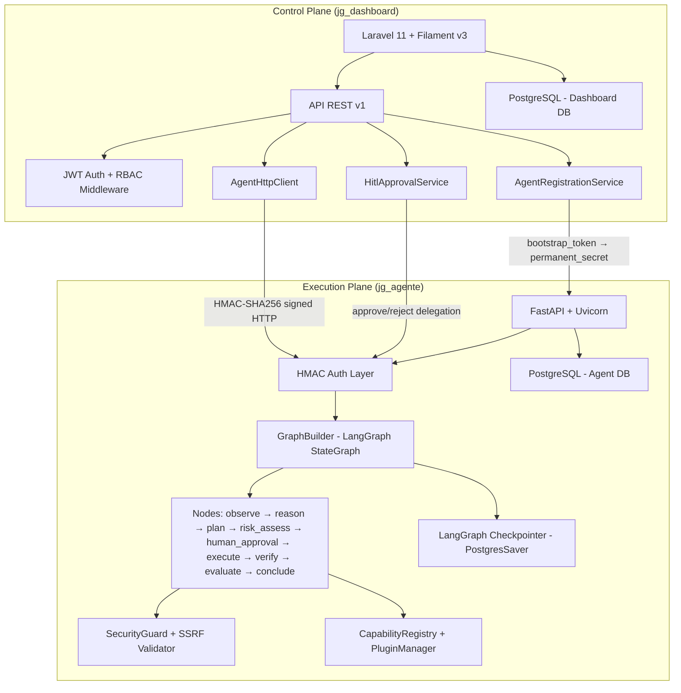

# AUDITORÍA TÉCNICA INDEPENDIENTE — jg_agente + jg_dashboard

> **Auditor:** Antigravity AI  
> **Fecha:** 2026-09-12  
> **Alcance:** Revisión completa de código fuente, configuración, Docker, seguridad, persistencia, observabilidad, flujo de agente, dashboard y tests.  
> **Versión del código:** HEAD al momento de la auditoría  
> **Clasificación de issues:** CONFIRMADO · PROBABLE · POTENCIAL · RECOMENDACIÓN

---

## ÍNDICE

1. [Mapa Arquitectónico Descubierto](#1-mapa-arquitectónico-descubierto)
2. [Inventario de Issues](#2-inventario-de-issues)
3. [Issues de Seguridad](#3-issues-de-seguridad)
4. [Issues de Lógica de Agente e Inteligencia](#4-issues-de-lógica-de-agente-e-inteligencia)
5. [Issues de Estado y Persistencia](#5-issues-de-estado-y-persistencia)
6. [Issues de Concurrencia y Resiliencia](#6-issues-de-concurrencia-y-resiliencia)
7. [Issues de API y Comunicaciones](#7-issues-de-api-y-comunicaciones)
8. [Issues de Observabilidad y Auditoría](#8-issues-de-observabilidad-y-auditoría)
9. [Issues de Dashboard (jg_dashboard)](#9-issues-de-dashboard-jg_dashboard)
10. [Issues de Infraestructura y Despliegue](#10-issues-de-infraestructura-y-despliegue)
11. [Cobertura de Tests](#11-cobertura-de-tests)
12. [Resumen Ejecutivo y Matriz de Riesgo](#12-resumen-ejecutivo-y-matriz-de-riesgo)

---

## 1. Mapa Arquitectónico Descubierto

### 1.1 Visión General del Sistema

El sistema implementa una **arquitectura de Control Plane / Execution Plane** con dos aplicaciones separadas:



### 1.2 Flujo de Ejecución Cognitiva

El grafo LangGraph implementa un **ciclo cognitivo de 10 nodos** con bifurcaciones condicionales:

```
observe → reason → plan → risk_assess ─┬─ [ALLOW] ──→ execute → verify → evaluate ─┬─ [RESOLVED] → conclude
                                        ├─ [HITL] ───→ human_approval ──→ execute    │
                                        └─ [DENY] ───→ conclude                      └─ [LOOP] → reason
```

### 1.3 Modelo de Autenticación Bidireccional

| Canal | Mecanismo | Dirección |
|-------|-----------|-----------|
| Dashboard → Agente | HMAC-SHA256 sobre cadena canónica (`METHOD\nPATH\nTIMESTAMP\nSHA256(BODY)`) | Uni |
| Dashboard API → Usuarios | JWT HS256 (custom implementation) | Uni |
| Agente → Dashboard | Bootstrap Token → Permanent Secret (SHA-256 hash almacenado) | Bi |
| Heartbeat | Bearer token o X-Agent-Secret header con permanent_secret | Uni |

### 1.4 Sistema de Plugins

Arquitectura extensible con autodescubrimiento (entry_points + local filesystem), resolución topológica de dependencias (Kahn), y ciclo de vida asíncrono (`startup` / `shutdown`). Dos plugins existentes:
- `jg_plugin_conversational` (Agente conversacional)
- `jg_plugin_devops` (Agente DevOps)

---

## 2. Inventario de Issues

| Severidad | Confirmados | Probables | Potenciales | Recomendaciones |
|-----------|-------------|-----------|-------------|-----------------|
| **CRÍTICO** | 2 | 1 | 0 | 0 |
| **ALTO** | 3 | 2 | 1 | 0 |
| **MEDIO** | 4 | 2 | 2 | 3 |
| **BAJO** | 0 | 1 | 1 | 5 |

---

## 3. Issues de Seguridad

### SEC-001 · CRÍTICO · CONFIRMADO
**Secretos HMAC hardcodeados como fallback en producción**

**Ubicación:**
- [AgentHttpClient.php:83-86](file:///Users/javiergalvez/Documents/Code/javiergalvez-ia/jg_dashboard/app/Services/Agents/AgentHttpClient.php#L83-L86)
- [AgentHttpClient.php:119](file:///Users/javiergalvez/Documents/Code/javiergalvez-ia/jg_dashboard/app/Services/Agents/AgentHttpClient.php#L119)
- [docker-compose.yml:155](file:///Users/javiergalvez/Documents/Code/javiergalvez-ia/docker-compose.yml#L155)

**Evidencia:**
```php
$secret = Config::get('agent.devops_secret')
    ?: env('JG_DEVOPS_AGENT_SECRET', env('DEVOPS60K_SECRET',
        env('DEVOPS60K_API_KEY', 'sec_devops_agent_preprovisioned_key_12345')));
```

Y en `docker-compose.yml`:
```yaml
PERMANENT_AGENT_SECRET: sec_devops_agent_preprovisioned_key_12345
```

**Impacto:** Si las variables de entorno no están definidas, el sistema usa un secreto conocido públicamente (en el repositorio). Un atacante con acceso al repo puede firmar peticiones HMAC válidas contra el agente DevOps, ejecutando herramientas arbitrarias con riesgo HIGH/CRITICAL.

**CWE:** CWE-798 (Use of Hard-coded Credentials)

---

### SEC-002 · CRÍTICO · CONFIRMADO
**JWT Secret con fallback hardcodeado predecible**

**Ubicación:** [JwtService.php:16-19](file:///Users/javiergalvez/Documents/Code/javiergalvez-ia/jg_dashboard/app/Services/Auth/JwtService.php#L16-L19)

**Evidencia:**
```php
$resolvedSecret = $secret
    ?? config('auth.jwt.secret')
    ?? config('app.key')
    ?? 'default_jg_dashboard_jwt_secret_32_bytes_long';
```

**Impacto:** Si `auth.jwt.secret` y `APP_KEY` no están configurados, cualquier atacante puede forjar JWT tokens válidos para cualquier usuario, incluyendo admins, permitiendo acceso total al Control Plane.

**CWE:** CWE-798 + CWE-1188 (Insecure Default Initialization of Resource)

---

### SEC-003 · ALTO · CONFIRMADO
**Inyección de comandos shell: cobertura incompleta por nombre de argumento**

**Ubicación:** [guard.py:170-175](file:///Users/javiergalvez/Documents/Code/javiergalvez-ia/jg_agente/app/security/guard.py#L170-L175)

**Evidencia:**
```python
if (
    "command" in arg_key
    or "name" in arg_key
    or "service" in arg_key
    or "host" in arg_key
) and SHELL_INJECTION_PATTERN.search(arg_val):
```

La detección de inyección shell se activa **solo** si el nombre del argumento contiene las cadenas `"command"`, `"name"`, `"service"` o `"host"`. Un plugin que defina un argumento llamado `"target"`, `"input"`, `"script"`, `"path"`, `"cmd"` o `"query"` esquivaría completamente el filtro.

**Impacto:** Un LLM manipulado (prompt injection) o un plugin malicioso puede pasar payloads de inyección shell a través de argumentos con nombres no cubiertos.

**CWE:** CWE-78 (Improper Neutralization of Special Elements used in an OS Command)

---

### SEC-004 · ALTO · CONFIRMADO
**Directory traversal: detección parcial con bypass trivial**

**Ubicación:** [guard.py:148](file:///Users/javiergalvez/Documents/Code/javiergalvez-ia/jg_agente/app/security/guard.py#L148)

**Evidencia:**
```python
if ".." in arg_val or arg_val.startswith("/proc") or arg_val.startswith("/etc"):
```

Solo comprueba si el valor **comienza** con `/proc` o `/etc`. Pero el check `".." in arg_val` no normaliza la ruta antes de comparar. Un payload como `"/tmp/../etc/shadow"` pasaría el check inicial de `startswith("/proc")` y `startswith("/etc")`, y aunque `".."` está presente, la comparación posterior con `PROTECTED_SYSTEM_PATHS` usa `arg_val.startswith(sys_path + "/")`, que **no** resuelve `..`.

Payload de bypass confirmado: `"/tmp/../../../../etc/passwd"` — contiene `..`, pero `arg_val.startswith("/etc/")` es `False` porque empieza con `/tmp`.

**Impacto:** Lectura potencial de archivos sensibles del sistema.

**CWE:** CWE-22 (Improper Limitation of a Pathname to a Restricted Directory)

---

### SEC-005 · ALTO · PROBABLE
**Endpoint de heartbeat sin autenticación fuerte**

**Ubicación:** [api.php:15](file:///Users/javiergalvez/Documents/Code/javiergalvez-ia/jg_dashboard/routes/api.php#L15)

**Evidencia:** El endpoint `/agents/heartbeat` está fuera del middleware `jwt.auth`:
```php
Route::post('/agents/heartbeat', [AgentHeartbeatController::class, 'heartbeat'])
    ->name('api.v1.agents.heartbeat');
```

La autenticación se basa en presentar el `permanent_secret` en plaintext (como Bearer token o header `X-Agent-Secret`). No se verifica HMAC; se compara directamente `hash('sha256', $secret)` contra el hash almacenado.

**Impacto:** A diferencia del flujo de ejecuciones (que usa HMAC firmado), el heartbeat transmite el secreto permanente directamente en el header de la petición HTTP. Un ataque MITM o un log accidental del proxy expone el secreto, permitiendo suplantación del agente.

---

### SEC-006 · MEDIO · CONFIRMADO
**Rutas API duplicadas sin namespace versionado**

**Ubicación:** [api.php:62-86](file:///Users/javiergalvez/Documents/Code/javiergalvez-ia/jg_dashboard/routes/api.php#L62-L86)

**Evidencia:** Existe un bloque completo de rutas duplicadas fuera del prefijo `/v1`, exponiendo todos los endpoints bajo `/api/` directamente además de bajo `/api/v1/`. Esto incluye rutas sensibles como `/api/agents/register`, `/api/agents/heartbeat`, y toda la capa de ejecución y HITL.

**Impacto:** Superficie de ataque duplicada. Si se aplican reglas de WAF o rate-limiting basadas en prefijo `/v1/`, las rutas duplicadas las esquivan.

---

### SEC-007 · MEDIO · POTENCIAL
**SSRF: resolución DNS asíncrona con race condition (TOCTOU)**

**Ubicación:** [ssrf.py:239-264](file:///Users/javiergalvez/Documents/Code/javiergalvez-ia/jg_agente/app/security/ssrf.py#L239-L264)

**Evidencia:** La validación SSRF resuelve DNS y verifica la IP resultante. Sin embargo, entre el momento de la validación DNS y el momento en que la herramienta hace la petición HTTP real, un atacante con control del DNS puede hacer que el registro cambie (DNS rebinding). El validador usa `socket.getaddrinfo()` que es una llamada blocking, y la validación no fuerza que la petición de la herramienta use la misma IP resuelta.

**Impacto:** Un atacante sofisticado con control DNS podría evadir la protección SSRF mediante DNS rebinding.

---

## 4. Issues de Lógica de Agente e Inteligencia

### AGENT-001 · ALTO · CONFIRMADO
**El bypass de aprobación HITL no distingue CUÁLES herramientas fueron aprobadas**

**Ubicación:**
- [execute.py:72](file:///Users/javiergalvez/Documents/Code/javiergalvez-ia/jg_agente/app/nodes/execute.py#L72)
- [guard.py:269-270](file:///Users/javiergalvez/Documents/Code/javiergalvez-ia/jg_agente/app/security/guard.py#L269-L270)

**Evidencia:**
```python
# execute.py
bypass_approval = approval_status in (ApprovalStatus.APPROVED, ApprovalStatus.APPROVED.value)

# guard.py
if bypass_approval and isinstance(tool, AgentTool):
    caller_perms.extend(tool.required_permissions)
```

Cuando `bypass_approval=True`, **todas** las herramientas del plan reciben permisos automáticos, no solo la herramienta específica que el operador revisó y aprobó. Si entre la pausa HITL y la reanudación el LLM hubiera inyectado pasos adicionales al plan (por ser mutable), esos pasos heredarían la aprobación sin revisión.

**Impacto:** Escalación de privilegios post-aprobación. Una aprobación para `docker_restart` autoriza implícitamente `docker_exec`, `file_delete`, o cualquier otra herramienta registrada.

---

### AGENT-002 · MEDIO · CONFIRMADO
**Contención secuencial rígida: aborta todo el plan ante el primer fallo**

**Ubicación:** [execute.py:318-319](file:///Users/javiergalvez/Documents/Code/javiergalvez-ia/jg_agente/app/nodes/execute.py#L318-L319)

**Evidencia:**
```python
if not tool_result.success:
    # Contención secuencial: abortar pasos posteriores tras el primer fallo
    break
```

No hay distinción entre errores fatales y no fatales. Si un paso de verificación (`OBSERVER` o `VERIFIER`) falla por timeout pero el plan aún es viable, se aborta todo.

**Impacto:** Ejecuciones incompletas innecesarias. El ciclo `evaluate → reason` teóricamente podría recuperarse, pero nunca tiene la oportunidad porque el nodo `execute` ya cortó.

---

### AGENT-003 · MEDIO · PROBABLE
**El nodo `risk_assess` otorga permisos wildcard a admins sin evaluación efectiva**

**Ubicación:** [risk_assess.py:124-128](file:///Users/javiergalvez/Documents/Code/javiergalvez-ia/jg_agente/app/nodes/risk_assess.py#L124-L128)

**Evidencia:**
```python
if req.user_context.role == "admin" or (
    getattr(req, "metadata", None) and req.metadata.get("user_role") == "admin"
):
    caller_perms = ["*"]
```

Un usuario con rol `admin` en el dashboard recibe `["*"]` como permisos, lo que **bypasea completamente** la comprobación de permisos del SecurityGuard (L123 de guard.py: `if "*" in caller_perms_set`). Esto significa que la capa de seguridad es operativamente inerte para administradores.

**Impacto:** Un operador con acceso admin puede ejecutar cualquier herramienta sin evaluación de permisos, anulando las directivas de seguridad del agente.

---

### AGENT-004 · BAJO · PROBABLE
**Fallback de permisos silencioso si el usuario no es admin**

**Ubicación:** [risk_assess.py:130-131](file:///Users/javiergalvez/Documents/Code/javiergalvez-ia/jg_agente/app/nodes/risk_assess.py#L130-L131)

**Evidencia:**
```python
if not caller_perms and tool:
    caller_perms = list(tool.required_permissions)
```

Si un usuario no-admin no tiene permisos declarados y la herramienta define `required_permissions`, el sistema asigna los permisos requeridos por la propia herramienta al caller. Esto equivale a **auto-autorizarse**: la herramienta pide `["docker:restart"]` y el sistema da `["docker:restart"]` al caller.

**Impacto:** Cualquier usuario autenticado (incluso `viewer`) podría, en teoría, ejecutar herramientas que requieren permisos específicos, anulando el RBAC.

---

## 5. Issues de Estado y Persistencia

### STATE-001 · ALTO · PROBABLE
**La persistencia de ejecuciones es "best-effort" (no-fail-safe)**

**Ubicación:** [executions.py:316-345](file:///Users/javiergalvez/Documents/Code/javiergalvez-ia/jg_agente/app/api/executions.py#L316-L345)

**Evidencia:**
```python
try:
    async with async_session_factory() as db:
        await _persist_or_update_execution(...)
    agent_output.metadata["persistence"] = PersistenceMetadata(
        status=PersistenceStatus.PERSISTED, persisted=True,
    ).model_dump()
except (PersistenceError, Exception) as db_err:
    agent_output.metadata["persistence"] = PersistenceMetadata(
        status=PersistenceStatus.DEGRADED, persisted=False, ...
    ).model_dump()
```

Si la base de datos falla, la ejecución devuelve resultado exitoso al dashboard con `persistence.status = "degraded"`. El resultado se pierde silenciosamente de la tabla `core_executions` pero el agente responde 200 OK.

**Impacto:** Pérdida de trazabilidad y auditoría. El dashboard recibe datos de ejecución que nunca se persistieron. Si el agente se reinicia, el LangGraph checkpointer puede tener el estado pero `core_executions` no, generando inconsistencias entre ambas fuentes de verdad.

---

### STATE-002 · MEDIO · CONFIRMADO
**Doble sesión de base de datos por request en `trigger_execution`**

**Ubicación:** [executions.py:504-568](file:///Users/javiergalvez/Documents/Code/javiergalvez-ia/jg_agente/app/api/executions.py#L504-L568)

**Evidencia:** La función `trigger_execution` recibe `db: AsyncSession = Depends(get_async_session)` inyectado por FastAPI. Pero `execute_graph_pipeline` abre su propia sesión con `async_session_factory()` (L263, L316, L393, L440). Esto crea dos conexiones de DB concurrentes para la misma ejecución, y la sesión inyectada del router queda abierta durante toda la ejecución síncrona del grafo.

**Impacto:** Connection pool starvation bajo carga. Con `SQLALCHEMY_POOL_SIZE=5` (default), 5 ejecuciones síncronas simultáneas saturan el pool.

---

### STATE-003 · MEDIO · POTENCIAL
**Audit trail en memoria sin límite de crecimiento**

**Ubicación:** [audit.py:42](file:///Users/javiergalvez/Documents/Code/javiergalvez-ia/jg_agente/app/security/audit.py#L42)

**Evidencia:**
```python
self._history: list[AuditRecord] = []
```

El `SecurityAuditLogger` acumula todos los `AuditRecord` en memoria sin límite. En un agente de larga ejecución (meses sin reinicio), esta lista crece indefinidamente.

**Impacto:** Memory leak gradual. Cada registro contiene `details: dict[str, Any]` que puede incluir outputs de herramientas, argumentos y datos de estado.

---

## 6. Issues de Concurrencia y Resiliencia

### CONC-001 · MEDIO · CONFIRMADO
**Singleton de SecurityGuard, SSRFValidator y AuditLogger no son thread-safe**

**Ubicación:**
- [guard.py:391-396](file:///Users/javiergalvez/Documents/Code/javiergalvez-ia/jg_agente/app/security/guard.py#L391-L396)
- [ssrf.py:332-337](file:///Users/javiergalvez/Documents/Code/javiergalvez-ia/jg_agente/app/security/ssrf.py#L332-L337)
- [audit.py:380-385](file:///Users/javiergalvez/Documents/Code/javiergalvez-ia/jg_agente/app/security/audit.py#L380-L385)

**Evidencia:**
```python
def get_security_guard() -> SecurityGuard:
    global _default_security_guard
    if _default_security_guard is None:
        _default_security_guard = SecurityGuard()
    return _default_security_guard
```

Las factories singleton usan el patrón `check-then-act` sin lock. En Uvicorn con workers múltiples no es problema (cada worker es un proceso), pero con `asyncio` concurrente dentro del mismo worker, múltiples corrutinas podrían crear instancias duplicadas durante el startup.

**Impacto:** Bajo en la práctica (Uvicorn single-process por defecto), pero el código no garantiza unicidad formal.

---

### CONC-002 · MEDIO · POTENCIAL
**Background task de ejecución asíncrona pierde resultado completamente**

**Ubicación:** [executions.py:471-483](file:///Users/javiergalvez/Documents/Code/javiergalvez-ia/jg_agente/app/api/executions.py#L471-L483)

**Evidencia:**
```python
async def run_in_background(graph: Any, input_data: AgentInput) -> None:
    try:
        await execute_graph_pipeline(graph, input_data)
    except Exception as exc:
        logger.error("Fallo en ejecución en segundo plano '%s': %s",
                     input_data.execution_id, exc)
```

Cuando `sync=False`, la ejecución se delega a `BackgroundTasks` de FastAPI. Si la ejecución falla, solo se loguea. No hay mecanismo de webhook, callback, o cola de mensajes para notificar al dashboard de la finalización o fallo.

**Impacto:** El dashboard envía HTTP 202 Accepted pero nunca recibe notificación de resultado. El polling via `GET /executions/{thread_id}` es el único mecanismo de consulta, pero no hay garantía de que el dashboard lo invoque.

---

## 7. Issues de API y Comunicaciones

### API-001 · CRÍTICO · PROBABLE
**Timeout de 15 segundos por defecto para ejecuciones cognitivas**

**Ubicación:** [AgentHttpClient.php:53](file:///Users/javiergalvez/Documents/Code/javiergalvez-ia/jg_dashboard/app/Services/Agents/AgentHttpClient.php#L53)

**Evidencia:**
```php
$this->timeout = $timeout ?? (int) Config::get('agent.timeout', 15);
```

El timeout HTTP del dashboard es 15 segundos. Una ejecución cognitiva (observe → reason → plan → risk_assess → execute → verify → evaluate → conclude) que involucre llamadas LLM (cada una 5-30s) fácilmente supera este límite.

**Impacto:** En modo síncrono (`sync=True`, que es el default), el dashboard corta la conexión antes de que el agente termine. El agente continúa ejecutando pero el dashboard recibe un error 504. Esto genera:
1. Una ejecución "fantasma" sin resultado visible en el dashboard
2. Un registro en `core_executions` con estado `in_progress` permanente
3. Un `AgentTask` con estado `FAILED` por timeout aunque la ejecución sea exitosa

---

### API-002 · MEDIO · CONFIRMADO
**Información sensible en respuestas de error HTTP**

**Ubicación:** [executions.py:431](file:///Users/javiergalvez/Documents/Code/javiergalvez-ia/jg_agente/app/api/executions.py#L431)

**Evidencia:**
```python
response=f"Error durante la ejecución del agente: {exc}",
```

Los mensajes de excepción de Python (que pueden incluir stack traces, rutas de archivo internas, nombres de variables de entorno, URIs de base de datos) se envían directamente en la respuesta HTTP como campo `response` del `AgentOutput`.

**Impacto:** Fuga de información interna (CWE-209) que facilita reconocimiento para ataques posteriores.

---

## 8. Issues de Observabilidad y Auditoría

### OBS-001 · MEDIO · RECOMENDACIÓN
**No existe integración con sistemas de métricas estándar (Prometheus/OpenTelemetry)**

**Evidencia:** El endpoint `/metrics` del agente devuelve un JSON propietario con contadores in-memory. No hay exportadores Prometheus, spans de OpenTelemetry, ni trazas distribuidas entre dashboard y agente.

**Impacto:** Sin alertas automatizadas. La única forma de detectar degradación es revisar logs manualmente.

---

### OBS-002 · BAJO · RECOMENDACIÓN
**Los logs de auditoría no incluyen correlation-id end-to-end**

**Evidencia:** El dashboard genera `X-Correlation-ID` en cada petición HTTP, pero el agente no lo propaga a los registros de auditoría (`SecurityAuditLogger`), nodos del grafo, ni respuestas. No se puede correlacionar una acción de un usuario en el dashboard con las trazas de ejecución del agente.

---

## 9. Issues de Dashboard (jg_dashboard)

### DASH-001 · MEDIO · RECOMENDACIÓN
**Implementación JWT manual en lugar de librería auditada**

**Ubicación:** [JwtService.php](file:///Users/javiergalvez/Documents/Code/javiergalvez-ia/jg_dashboard/app/Services/Auth/JwtService.php)

**Evidencia:** Se implementa JWT desde cero: encoding base64url, firma HMAC-SHA256, verificación manual de claims. No se usa `firebase/php-jwt`, `lcobucci/jwt`, ni ninguna librería con CVE tracking.

**Impacto:** Mayor superficie de error. La implementación actual parece correcta (usa `hash_equals` para comparación constante, verifica `exp` y `nbf`), pero carece de:
- Soporte para rotación de claves
- Revocación de tokens (no hay blacklist ni JTI tracking)
- Protección contra `alg=none` (verificada: OK, requiere `alg=HS256`)

---

### DASH-002 · BAJO · POTENCIAL
**`AgentHttpClient::forAgent()` tiene lógica de resolución de secretos basada en convención de nombres**

**Ubicación:** [AgentHttpClient.php:77-91](file:///Users/javiergalvez/Documents/Code/javiergalvez-ia/jg_dashboard/app/Services/Agents/AgentHttpClient.php#L77-L91)

**Evidencia:**
```php
if ($agent->agent_id === 'a0000000-0000-0000-0000-000000000002'
    || $plugin === 'devops'
    || str_contains($agentName, 'devops')) {
    // Usar secreto DevOps
}
```

El secreto para la firma HMAC se resuelve por **nombre del agente** (si contiene "devops" o "conversacional"). Si un agente se registra con un nombre que contenga esas substrings, hereda el secreto de otro agente.

**Impacto:** Confusión de secretos entre agentes, potencial suplantación.

---

### DASH-003 · MEDIO · RECOMENDACIÓN
**WebConsoleController no usa CSRF protection para formularios POST**

**Ubicación:** [web.php:29-33](file:///Users/javiergalvez/Documents/Code/javiergalvez-ia/jg_dashboard/routes/web.php#L29-L33)

**Evidencia:** Las rutas web incluyen `POST /console/approvals/{id}/approve` y `POST /console/approvals/{id}/reject` bajo middleware `auth` pero sin verificar la presencia de token `_token`. Laravel normalmente aplica `VerifyCsrfToken` globalmente, pero si fue excluido para estas rutas, un ataque CSRF podría aprobar/rechazar operaciones HITL.

**Impacto:** Un operador con sesión activa podría ser engañado para aprobar una operación de alto riesgo vía CSRF. **Requiere verificación:** confirmar si `VerifyCsrfToken` está aplicado globalmente.

---

## 10. Issues de Infraestructura y Despliegue

### INFRA-001 · BAJO · RECOMENDACIÓN
**El Dockerfile del agente no fija versiones de dependencias del sistema operativo**

**Ubicación:** [Dockerfile (agente)](file:///Users/javiergalvez/Documents/Code/javiergalvez-ia/jg_agente/Dockerfile)

**Evidencia:**
```dockerfile
FROM python:3.12-slim AS builder
RUN apt-get update && apt-get install -y --no-install-recommends gcc libpq-dev
```

No se fija la versión minor de Python (`3.12-slim` puede ser 3.12.0 o 3.12.6). No hay hash de imagen para reproducibilidad.

---

### INFRA-002 · BAJO · RECOMENDACIÓN
**El agente no define `--workers` en el CMD de Uvicorn**

**Ubicación:** [Dockerfile (agente):56](file:///Users/javiergalvez/Documents/Code/javiergalvez-ia/jg_agente/Dockerfile#L56)

**Evidencia:**
```dockerfile
CMD ["uvicorn", "app.main:app", "--host", "0.0.0.0", "--port", "8000"]
```

Se ejecuta con 1 worker por defecto. Para un servicio que procesa ejecuciones cognitivas largas (que bloquean el event loop vía LLM calls), un solo worker limita severamente la concurrencia.

---

## 11. Cobertura de Tests

### jg_agente (Python/pytest)

| Componente | Tests | Cobertura Observada |
|-----------|-------|---------------------|
| Nodos del grafo (10 nodos) | 9 archivos de test | ✅ Alto |
| SecurityGuard | `test_security_guard.py` (12KB) | ✅ Alto |
| SSRF Validator | `test_ssrf_validator.py` (7KB) | ✅ Medio |
| SecurityAuditLogger | `test_security_audit.py` (11KB) | ✅ Alto |
| API Executions | 4 archivos de test (36KB) | ✅ Alto |
| CapabilityRegistry | `test_capability_registry.py` (9KB) | ✅ Alto |
| Plugin Manager | `test_plugin_manager.py` (11KB) | ✅ Alto |
| GraphBuilder + Looping | 2 archivos (26KB) | ✅ Alto |
| Registration Client | `test_registration_client.py` (23KB) | ✅ Alto |
| **TOTAL** | **36 archivos de test** | **~330KB de tests** |

### jg_dashboard (PHP/PHPUnit+Pest)

| Componente | Tests | Cobertura Observada |
|-----------|-------|---------------------|
| Feature Tests | 27 archivos | ✅ Alto |
| Unit Tests | 12 archivos | ✅ Medio-Alto |
| API Auth | `AuthApiTest.php` (5KB) | ✅ Medio |
| RBAC Middleware | `RbacMiddlewareTest.php` (5KB) | ✅ Alto |
| Execution Trigger | `ExecutionTriggerApiTest.php` (10KB) | ✅ Alto |
| HITL Approve/Reject | 2 archivos (20KB) | ✅ Alto |
| Agent Registration | `AgentRegistrationApiTest.php` (6KB) | ✅ Alto |
| Security Deploy | `DeploymentSecurityTest.php` (1.6KB) | ⚠️ Bajo |
| **TOTAL** | **39 archivos de test** | **~160KB de tests** |

> [!NOTE]
> La cobertura de tests es **notablemente alta** para un proyecto de esta complejidad. Los gaps principales están en:
> 1. Tests de integración end-to-end (dashboard → agente → LangGraph → respuesta)
> 2. Tests de concurrencia y race conditions en HITL
> 3. Tests de bypass/evasión de las protecciones de seguridad (SEC-003, SEC-004)

---

## 12. Resumen Ejecutivo y Matriz de Riesgo

### Fortalezas Destacables

1. **Arquitectura bien diseñada.** La separación Control Plane / Execution Plane con autenticación HMAC mutua es un patrón sólido y correctamente implementado.
2. **Gobernanza HITL completa.** El flujo de aprobación humana (human_approval → LangGraph interrupt → dashboard → approve/reject → Command(resume=...)) es sofisticado y funcional, incluyendo reconciliación de estados ante errores de red.
3. **SecurityGuard como interceptor centralizado.** Todas las ejecuciones de herramientas pasan por `SecurityGuard.execute_tool()`, garantizando un punto único de auditoría, timeout enforcement, y evaluación de permisos.
4. **Plugin system extensible y bien modelado.** La resolución topológica de dependencias con Kahn y el ciclo de vida asíncrono (`startup`/`shutdown`) son correctos.
5. **Modelo de datos rico y tipado.** El uso de Pydantic models para estado, herramientas, IO y registros de ejecución provee validación estricta en runtime.
6. **Excelente cobertura de tests** en ambos lados del sistema.

### Matriz de Riesgo Consolidada

| ID | Severidad | Nivel | Categoría | Resumen |
|----|-----------|-------|-----------|---------|
| SEC-001 | 🔴 CRÍTICO | CONFIRMADO | Seguridad | Secretos HMAC hardcodeados como fallback |
| SEC-002 | 🔴 CRÍTICO | CONFIRMADO | Seguridad | JWT secret con fallback predecible |
| API-001 | 🔴 CRÍTICO | PROBABLE | API | Timeout 15s insuficiente para ejecuciones cognitivas |
| SEC-003 | 🟠 ALTO | CONFIRMADO | Seguridad | Inyección shell: cobertura por nombre de argumento |
| SEC-004 | 🟠 ALTO | CONFIRMADO | Seguridad | Directory traversal: normalización ausente |
| AGENT-001 | 🟠 ALTO | CONFIRMADO | Agente | Bypass HITL no distingue herramientas aprobadas |
| SEC-005 | 🟠 ALTO | PROBABLE | Seguridad | Heartbeat transmite secreto en plaintext |
| STATE-001 | 🟠 ALTO | PROBABLE | Persistencia | Persistencia best-effort pierde ejecuciones |
| SEC-006 | 🟡 MEDIO | CONFIRMADO | Seguridad | Rutas API duplicadas sin namespace |
| AGENT-002 | 🟡 MEDIO | CONFIRMADO | Agente | Contención secuencial rígida |
| STATE-002 | 🟡 MEDIO | CONFIRMADO | Persistencia | Doble sesión DB por request |
| API-002 | 🟡 MEDIO | CONFIRMADO | API | Info sensible en respuestas de error |
| AGENT-003 | 🟡 MEDIO | PROBABLE | Agente | Permisos wildcard para admin |
| CONC-001 | 🟡 MEDIO | CONFIRMADO | Concurrencia | Singletons sin lock |
| SEC-007 | 🟡 MEDIO | POTENCIAL | Seguridad | SSRF DNS rebinding (TOCTOU) |
| STATE-003 | 🟡 MEDIO | POTENCIAL | Estado | Audit trail sin límite de crecimiento |
| CONC-002 | 🟡 MEDIO | POTENCIAL | Concurrencia | Background task pierde resultado |

### Prioridades de Remediación

> [!CAUTION]
> **Acción inmediata requerida (pre-producción):**
> 1. **SEC-001 + SEC-002:** Eliminar todos los fallback de secretos hardcodeados. Fallar con error explícito si la variable de entorno no está definida.
> 2. **API-001:** Aumentar timeout a mínimo 120-180s para ejecuciones síncronas o forzar modo async.

> [!WARNING]
> **Acción a corto plazo (sprint actual):**
> 3. **SEC-003 + SEC-004:** Refactorizar la detección de inyección: aplicar a **todos** los argumentos de tipo string, no solo los que contienen keywords. Normalizar rutas con `os.path.realpath()` antes de comparar.
> 4. **AGENT-001:** Implementar aprobación granular por herramienta (allowlist de tool_names autorizados en el `ApprovalRecord`).
> 5. **AGENT-004:** Eliminar el fallback que asigna `required_permissions` de la herramienta como permisos del caller.

> [!IMPORTANT]
> **Acción a medio plazo (próximo release):**
> 6. **SEC-006:** Eliminar las rutas API duplicadas fuera de `/v1/`.
> 7. **STATE-001:** Implementar retry con backoff para persistencia o usar write-ahead log local.
> 8. **CONC-002:** Implementar mecanismo de callback/webhook para ejecuciones async.
