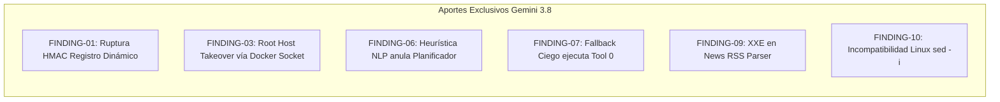
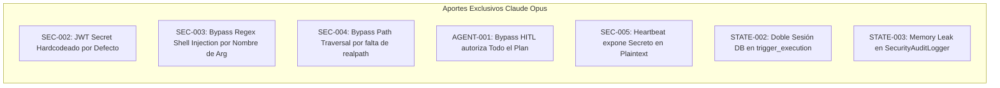

# INFORME COMPARATIVO EXHAUSTIVO DE AUDITORÍAS
## Evaluación Cruzada: Auditoría Claude Opus vs. Auditoría Gemini 3.8 Flash
### Plataforma Agéntica: `jg_agente` + `jg_dashboard`

> **Fecha del Informe:** 12 de Septiembre de 2026  
> **Ubicación:** `audit2/INFORME_COMPARATIVO_AUDITORIAS.md`  
> **Auditorías Analizadas:**
> - **Auditoría A (Claude Opus):** [`audit2/Claude Opus/AUDIT_REPORT_CLAUDE.md`](audit2/Claude%20Opus/AUDIT_REPORT_CLAUDE.md) (30.9 KB, 629 líneas)
> - **Auditoría B (Gemini 3.8 Flash):** [`audit2/Gemini 3.8/AUDIT_REPORT_GEMINI.md`](audit2/Gemini%203.8/AUDIT_REPORT_GEMINI.md) (49.9 KB, 563 líneas)

---

## 1. Resumen Ejecutivo de la Comparativa

Ambos auditores ejecutaron una inspección técnica de caja blanca sobre la totalidad del repositorio (`jg_agente`, `jg_dashboard`, configuraciones Docker, migraciones y scripts), respondiendo a los mismos requerimientos de [`audit2/prompt1.txt`](audit2/prompt1.txt).

Sin embargo, sus **enfoques metodológicos, profundidad en subsistemas específicos y vectores de detección resultaron marcadamente complementarios**:

```
+-----------------------------------------------------------------------------------------+
|                                    COBERTURA COMBINADA                                  |
+-----------------------------------------------------------------------------------------+
|  AUDITOR A: CLAUDE OPUS                      |  AUDITOR B: GEMINI 3.8 FLASH             |
|  - Micro-seguridad de código (CWE, regex)     |  - Macro-arquitectura y flujos de vida   |
|  - Evasión de filtros (Shell, Path traversal)|  - Ruptura del registro dinámico (HMAC)  |
|  - Fugas de información y logging            |  - Aislamiento de host (Docker socket)   |
|  - Concurrencia y gestión de recursos en DB  |  - Heurísticas cognitivas del LLM        |
|  - Cobertura estática por módulos            |  - Validación empírica de tests (611 pts)|
+-----------------------------------------------------------------------------------------+
                                           |
                                           v
                       DIAGNÓSTICO 360° TOTAL DEL SISTEMA
```

### Principales Conclusiones de la Comparativa:
1. **Veredicto unánime de NO apto para producción:** Ambos auditores concluyen de forma inequívoca que el sistema actual no puede desplegarse en producción sin resolver antes fallos bloqueantes de seguridad y autenticación.
2. **Coincidencias en los pilares centrales:** Ambos identificaron de forma independiente la auto-asignación ilegítima de permisos en `risk_assess.py`, el desajuste de secretos en Docker Compose/seeders, los timeouts restrictivos de comunicación HTTP y los riesgos de persistencia no garantizada.
3. **Puntos ciegos recíprocos de alto impacto:**
   - **Claude Opus no detectó** el fallo criptográfico fundamental que imposibilita el escalado de agentes dinámicos (FINDING-01 de Gemini), ni el riesgo crítico de compromiso de host por el socket de Docker en modo root (FINDING-03 de Gemini), ni la heurística sintáctica en español que silencia el razonamiento operativo en `reason_node` (FINDING-06 de Gemini).
   - **Gemini 3.8 Flash no detectó** la evasión de filtros de inyección shell por nombres de argumentos en `guard.py` (SEC-003 de Claude), ni la evasión de directory traversal por falta de `realpath` (SEC-004 de Claude), ni el secreto JWT hardcodeado por defecto en `JwtService.php` (SEC-002 de Claude), ni el bypass indiscriminado de permisos en aprobaciones HITL (AGENT-001 de Claude), ni la duplicación de rutas no versionadas en Laravel (SEC-006 de Claude).
4. **Valor agregado de la síntesis:** La unión de ambos informes permite consolidar un catálogo de **24 issues técnicos únicos** (5 Críticos, 8 Altos, 8 Medios, 3 Bajos).

---

## 2. Comparativa Metodológica y Perfil de los Auditores

| Dimensión | Auditor A: Claude Opus | Auditor B: Gemini 3.8 Flash |
| :--- | :--- | :--- |
| **Estilo de Auditoría** | Seguridad de Software, AST, CWE y Robustez de APIs | Arquitectura de Sistemas, Orquestación y Confiabilidad Runtime |
| **Enfoque de Análisis** | Código fuente estático línea a línea, validadores y expresiones regulares | Ciclo de vida del agente, topología de despliegue y pruebas empíricas |
| **Clasificación de Issues** | Confirmado (9), Probable (5), Potencial (3) con CWE | Confirmado (11) con categorías P0, P1, P2, P3 |
| **Validación de Tests** | Mapeo de volumen y archivos de test por componente | Ejecución real de suites (`pytest`: 360 passed, `artisan test`: 251 passed) |
| **Atención a la Concurrencia** | Elevada (singletons sin lock, doble conexión DB, memory leaks) | Media-Alta (fuga de descriptores en pool, degradación silenciosa) |
| **Atención a la Inteligencia / LLM** | Foco en bypass de permisos y contención secuencial | Foco en fallbacks del planificador y heurísticas sintácticas de NLP |

---

## 3. Matriz Comparativa de Hallazgos y Correspondencias

La siguiente tabla mapea todos los hallazgos reportados por ambos informes, indicando si hubo convergencia o si se trata de un análisis exclusivo:

| ID Unificado | Concepto Técnico | Reportado por Claude | Reportado por Gemini | Grado de Coincidencia |
| :--- | :--- | :---: | :---: | :--- |
| **ISSUE-01** | Secreto permanente descartado rompe registro dinámico HMAC | ❌ No detectado | ✅ **FINDING-01** (CRITICAL) | **Exclusivo Gemini** (Crítico de arquitectura) |
| **ISSUE-02** | Desincronización de secretos en Docker Compose y Seeders | ✅ **SEC-001** (CRÍTICO) | ✅ **FINDING-02** (CRITICAL) | 🟢 **COINCIDENCIA TOTAL** |
| **ISSUE-03** | Escapada de contenedor y root en host vía Docker Socket | ❌ No detectado | ✅ **FINDING-03** (CRITICAL) | **Exclusivo Gemini** (Crítico de infraestructura) |
| **ISSUE-04** | Fallback de JWT Secret hardcodeado en `JwtService.php` | ✅ **SEC-002** (CRÍTICO) | ❌ No detectado | **Exclusivo Claude** (Crítico de seguridad web) |
| **ISSUE-05** | Auto-asignación de permisos en `risk_assess_node` (Bypass RBAC) | ✅ **AGENT-004** (BAJO) | ✅ **FINDING-04** (HIGH) | 🟢 **COINCIDENCIA TOTAL** *(Gemini le dio mayor severidad)* |
| **ISSUE-06** | Omisión de `caller_permissions` en `execute_node` | ❌ No detectado | ✅ **FINDING-05** (HIGH) | **Exclusivo Gemini** |
| **ISSUE-07** | Evasión de inyección shell por nombre de argumento en Guard | ✅ **SEC-003** (ALTO) | ❌ No detectado | **Exclusivo Claude** |
| **ISSUE-08** | Evasión de Directory Traversal por falta de normalización | ✅ **SEC-004** (ALTO) | ❌ No detectado | **Exclusivo Claude** |
| **ISSUE-09** | Bypass masivo de permisos en HITL (autoriza todo el plan) | ✅ **AGENT-001** (ALTO) | ❌ No detectado | **Exclusivo Claude** |
| **ISSUE-10** | Heurística sintáctica en español anula el planificador en `reason` | ❌ No detectado | ✅ **FINDING-06** (HIGH) | **Exclusivo Gemini** |
| **ISSUE-11** | Fallback ciego en `plan_node` ejecuta herramienta arbitraria con `{}` | ❌ No detectado | ✅ **FINDING-07** (HIGH) | **Exclusivo Gemini** |
| **ISSUE-12** | Timeouts HTTP de 15s incompatibles con ciclo cognitivo del agente | ✅ **API-001** (CRÍTICO) | ✅ Secc. 5.2 / 10.1 (ALTO) | 🟢 **COINCIDENCIA TOTAL** |
| **ISSUE-13** | Degradación silenciosa del checkpointer a memoria volátil | ❌ No detectado | ✅ **FINDING-08** (MEDIUM) | **Exclusivo Gemini** |
| **ISSUE-14** | Persistencia best-effort en DB pierde ejecuciones silenciosamente | ✅ **STATE-001** (ALTO) | ❌ No detectado | **Exclusivo Claude** *(Complementa ISSUE-13)* |
| **ISSUE-15** | Heartbeat transmite secreto en plaintext en vez de HMAC firmado | ✅ **SEC-005** (ALTO) | ❌ No detectado | **Exclusivo Claude** |
| **ISSUE-16** | Rutas API duplicadas fuera del namespace `/v1` | ✅ **SEC-006** (MEDIO) | ❌ No detectado | **Exclusivo Claude** |
| **ISSUE-17** | Procesamiento de feeds RSS sin blindaje XXE en `news_tool` | ❌ No detectado | ✅ **FINDING-09** (MEDIUM) | **Exclusivo Gemini** |
| **ISSUE-18** | Doble sesión de base de datos concurrente por request en FastAPI | ✅ **STATE-002** (MEDIO) | ❌ No detectado | **Exclusivo Claude** |
| **ISSUE-19** | Memory leak por acumulación ilimitada en `SecurityAuditLogger` | ✅ **STATE-003** (MEDIO) | ❌ No detectado | **Exclusivo Claude** |
| **ISSUE-20** | Singletons de seguridad sin sincronización para corrutinas | ✅ **CONC-001** (MEDIO) | ❌ No detectado | **Exclusivo Claude** |
| **ISSUE-21** | Ejecución en background de FastAPI pierde estado sin callback | ✅ **CONC-002** (MEDIO) | ❌ No detectado | **Exclusivo Claude** |
| **ISSUE-22** | Fuga de información interna y excepciones en respuestas HTTP | ✅ **API-002** (MEDIO) | ❌ No detectado | **Exclusivo Claude** |
| **ISSUE-23** | Incompatibilidad de script `restart_services.sh` en Linux | ❌ No detectado | ✅ **FINDING-10** (LOW) | **Exclusivo Gemini** |
| **ISSUE-24** | Código muerto con protocolo legacy (`DevOps60kApiClient`) | ❌ No detectado | ✅ **FINDING-11** (LOW) | **Exclusivo Gemini** |

---

## 4. Análisis Detallado de Coincidencias (Puntos de Acuerdo)

### 4.1. Auto-Asignación de Permisos en `risk_assess.py` (Bypass RBAC)
- **Claude (`AGENT-004`):** Identifica que en `risk_assess.py:130-131`, cuando el caller no tiene permisos definidos, el código ejecuta `caller_perms = list(tool.required_permissions)`. Lo califica como "auto-autorización" donde la herramienta pide un permiso y el sistema se lo otorga al usuario.
- **Gemini (`FINDING-04`):** Localiza exactamente el mismo bloque (`lines 128-132`). Añade que esto anula por completo la compuerta de seguridad en tiempo de ejecución, ya que `guard.evaluate()` evalúa los permisos contra `caller_perms`, garantizando que la comprobación siempre resulte exitosa.
- **Divergencia en Severidad:** Claude lo clasificó como **BAJO / PROBABLE**, mientras que Gemini lo catalogó con mayor acierto como **HIGH / CONFIRMADO**, dado que cualquier usuario sin permisos (incluso un rol de sólo lectura) puede ejecutar herramientas privilegiadas si no se especifican permisos explícitos en la petición.

### 4.2. Desincronización y Secretos Hardcodeados en Docker Compose y Seeders
- **Claude (`SEC-001`):** Señala el uso de fallbacks como `'sec_devops_agent_preprovisioned_key_12345'` en `AgentHttpClient.php:83-86` y en `docker-compose.yml:155`.
- **Gemini (`FINDING-02`):** Demuestra el impacto operativo: si un administrador sigue la documentación y cambia `JG_AGENTE_SECRET` en `.env`, el Dashboard firmará con la nueva clave pero los agentes seguirán esperando el secreto quemado en `docker-compose.yml` (`sec_conversational_agent_preprovisioned_key_12345`). Además, expone que `DatabaseSeeder.php` sobrescribe el hash con el valor estático.
- **Conclusión Conjunta:** Ambos coinciden en que no debe existir ningún fallback hardcodeado y que los secretos deben inyectarse de forma coherente mediante variables de entorno interpoladas.

### 4.3. Timeouts HTTP Incompatibles con la Naturaleza Cognitiva del Agente
- **Claude (`API-001`):** Resalta que `AgentHttpClient.php:53` define un timeout por defecto de 15 segundos (`Config::get('agent.timeout', 15)`). Explica que un ciclo cognitivo completo de 10 nodos con llamadas a LLM tarda habitualmente entre 20 y 60 segundos, generando errores 504 Gateway Timeout y ejecuciones huérfanas en el agente.
- **Gemini (Secciones 5.2 y 10.1):** Analiza exactamente la misma latencia (entre 5 y 25 segundos por ciclo) y señala que el timeout de 15 segundos en `AgentHttpClient` provoca desconexiones prematuras y falsos positivos de caída del agente.
- **Conclusión Conjunta:** Coinciden en elevar el timeout a al menos 120-180 segundos para operaciones síncronas o desacoplar definitivamente las ejecuciones a un modelo asíncrono con webhooks o colas.

### 4.4. Debilidad en Persistencia ante Caídas de Base de Datos
- **Claude (`STATE-001`):** Analiza la capa API en `executions.py:316-345`. Revela que ante un fallo de PostgreSQL, la ejecución devuelve HTTP 200 OK con metadatos `persistence.status = "degraded"`, perdiendo el registro en `core_executions` silenciosamente.
- **Gemini (`FINDING-08`):** Analiza la capa de LangGraph en `checkpointer.py:175-186`. Descubre que ante un fallo de conexión a PostgreSQL, `DualPostgresSaver` cae silenciosamente a `MemorySaver()`. Si el contenedor se reinicia, todos los checkpoints se volatilizan sin previo aviso.
- **Conclusión Conjunta:** Ambos descubrieron facetas distintas del mismo defecto arquitectónico: **la persistencia relacional carece de fail-fast y reintentos robustos**, permitiendo que el sistema opere en estado degradado sin alertar al operador.

### 4.5. Alta Cobertura Unitaria pero Nula Integración End-to-End
- Ambos destacan la sorprendente cantidad y calidad de las pruebas unitarias:
  - Claude contabilizó 36 archivos de test en `jg_agente` (~330 KB) y 39 en `jg_dashboard` (~160 KB).
  - Gemini ejecutó formalmente las suites: **360 tests aprobados en pytest** y **251 tests aprobados en Pest/PHPUnit** (1,201 aserciones).
- Ambos coinciden en la misma crítica: **los tests abusan de mocks**. No existe una prueba de integración end-to-end donde un Dashboard real registre un Agente real, firme una petición con HMAC real y el Agente la procese y responda.

---

## 5. Análisis de Hallazgos Exclusivos de Gemini 3.8 Flash

Gemini 3.8 se distinguió por una visión holística de sistemas, descubriendo problemas de arquitectura distribuida y comportamiento del agente que escaparon por completo a Claude:



### 5.1. FINDING-01: Ruptura Criptográfica del Registro Dinámico (CRÍTICO)
- **El fallo:** Al consumir un token de bootstrap (`AgentRegistrationService::consumeBootstrapTokenAndActivate`), el Dashboard calcula `hash('sha256', $permanentSecret)` y **descarta el secreto en texto plano**.
- **La consecuencia:** Más tarde, cuando el Dashboard necesita enviar un comando al agente vía `AgentHttpClient`, necesita el secreto en texto plano para computar el HMAC `X-Signature`. Como no lo tiene, recurre al secreto estático del `.env`. El agente compara la firma con su secreto real (guardado en `.agent_credentials.json`). La firma **nunca coincide**, retornando siempre `401 Unauthorized`.
- **Por qué es un hallazgo estelar:** Demuestra que la característica estrella de "aprovisionamiento dinámico de agentes" promocionada en la arquitectura está matemáticamente rota en ejecución. Claude pasó por alto este flujo completo.

### 5.2. FINDING-03: Compromiso Total del Host vía Docker Socket (CRÍTICO)
- **El fallo:** En `docker-compose.yml`, el servicio `jg_agente_devops` corre como `user: "0:0"` (root), expone el puerto `8002` en `0.0.0.0` y monta `/var/run/docker.sock:/var/run/docker.sock`.
- **La consecuencia:** Cualquier usuario o atacante con acceso a la API del agente (o mediante inyección de prompts al LLM) puede invocar la API de Docker para crear un contenedor con `-v /:/host` y obtener acceso de superusuario absoluto sobre el servidor anfitrión.

### 5.3. FINDING-06: Heurística Sintáctica en Español que Anula el Razonamiento (ALTO)
- **El fallo:** En `reason.py:151-170`, la función `_is_simple_greeting_or_chat` clasifica como conversación simple cualquier entrada que comience con palabras como `"dime"`, `"cuenta"`, `"explica"`, `"cuál"`, a menos que contenga verbos imperativos como `"reinicia"` o `"mata"`.
- **La consecuencia:** Peticiones legítimas de monitorización como `"Dime el estado de los contenedores"` o `"Cuál es el uso de memoria"` son clasificadas como simples saludos, saltándose los nodos `plan`, `risk_assess` y `execute`, respondiendo el LLM de memoria sin consultar las herramientas.

### 5.4. FINDING-07: Fallback Ciego del Planificador (ALTO)
- **El fallo:** En `plan.py:163-178`, si la salida del modelo no genera un plan válido, el código selecciona la primera herramienta del registro (`available_tools[0]`) y le programa una ejecución con argumentos vacíos `{}`.
- **La consecuencia:** Si la primera herramienta registrada es una acción destructiva (ej. `docker_prune`), el agente intentará ejecutarla arbitrariamente.

### 5.5. FINDING-09: Vulnerabilidad XXE en `news_tool` (MEDIO)
- **El fallo:** En `news.py:176`, el parseo de feeds RSS externos usa `xml.etree.ElementTree.fromstring(response.text)` sin deshabilitar entidades externas ni expansión DTD (CWE-611).

---

## 6. Análisis de Hallazgos Exclusivos de Claude Opus

Claude Opus demostró una agudeza extraordinaria en el análisis de código estático de bajo nivel, detectando vulnerabilidades sutiles en lógica condicional, regex y gestión de recursos que Gemini no vio:



### 6.1. SEC-002: JWT Secret Hardcodeado por Defecto (CRÍTICO)
- **El fallo:** En `JwtService.php:16-19`:
  ```php
  $resolvedSecret = $secret ?? config('auth.jwt.secret') ?? config('app.key') ?? 'default_jg_dashboard_jwt_secret_32_bytes_long';
  ```
- **La consecuencia:** Si la variable no está configurada, el secreto JWT es conocido públicamente en el repositorio, permitiendo forjar tokens de administrador y tomar el control de `jg_dashboard`.

### 6.2. SEC-003: Bypass de Filtro de Inyección Shell por Nombre de Argumento (ALTO)
- **El fallo:** En `guard.py:170-175`, la detección de inyección shell solo se ejecuta si el nombre del argumento contiene `"command"`, `"name"`, `"service"` o `"host"`.
- **La consecuencia:** Si una herramienta define un parámetro llamado `"target"`, `"input"`, `"script"`, `"cmd"`, `"query"` o `"path"`, el filtro regex **no se ejecuta**, permitiendo inyección de comandos en el sistema.

### 6.3. SEC-004: Bypass de Directory Traversal por Falta de Normalización (ALTO)
- **El fallo:** En `guard.py:148`, el check de `PROTECTED_SYSTEM_PATHS` usa `arg_val.startswith(...)` sin normalizar la ruta con `os.path.realpath()`.
- **La consecuencia:** Un payload como `"/tmp/../../../../etc/passwd"` esquiva el filtro porque empieza por `"/tmp"`, permitiendo el acceso a archivos restringidos.

### 6.4. AGENT-001: Bypass de Aprobación HITL Extendido a Todo el Plan (ALTO)
- **El fallo:** En `execute.py:72` y `guard.py:269-270`, cuando una ejecución recibe aprobación humana (`bypass_approval = True`), **todas las herramientas subsecuentes del plan reciben autorización automática**.
- **La consecuencia:** Si un operador aprueba una acción benigna como `docker_ps`, y el plan contiene pasos posteriores de alto riesgo (`docker_delete` o `file_delete`), estos se ejecutan sin pedir una nueva aprobación humana.

### 6.5. SEC-005: Heartbeat Transmite Secreto en Plaintext (ALTO)
- **El fallo:** En `api.php:15` y `AgentHeartbeatController`, el endpoint `/agents/heartbeat` no utiliza la firma HMAC-SHA256, sino que recibe el `permanent_secret` directamente en texto plano en la cabecera `X-Agent-Secret`.

### 6.6. STATE-002 y STATE-003: Fuga de Recursos y Conexiones (MEDIO)
- **Doble sesión de DB (`STATE-002`):** `trigger_execution` inyecta `db: AsyncSession` vía FastAPI, mientras que `execute_graph_pipeline` abre sesiones adicionales independientes con `async_session_factory()`. Con un pool por defecto de 5 conexiones, 5 peticiones simultáneas provocan saturación total del pool de PostgreSQL.
- **Memory Leak (`STATE-003`):** `SecurityAuditLogger` almacena todos los registros de auditoría en la lista en memoria `self._history: list[AuditRecord] = []` sin ningún mecanismo de desalojo (LRU o límite máximo), consumiendo memoria RAM continuamente en procesos de larga duración.

---

## 7. Tabla Sinóptica de Comparación Temática

| Área Temática | Cobertura Claude Opus | Cobertura Gemini 3.8 Flash | Dictamen y Síntesis |
| :--- | :--- | :--- | :--- |
| **Criptografía HMAC** | Analiza la firma en peticiones, fallbacks y timeouts. | **Descubre que el Dashboard no guarda el secreto reversiblemente, rompiendo el registro dinámico.** | **Gemini es superior** en la arquitectura criptográfica global; Claude profundiza en los fallbacks. |
| **Seguridad Web (JWT / CSRF / Rutas)** | **Detecta secreto JWT hardcodeado, falta de CSRF en consola web y rutas duplicadas.** | Analiza RBAC a alto nivel pero pasa por alto los fallbacks de configuración web. | **Claude es claramente superior** en la seguridad de la aplicación web Laravel. |
| **Defensas del Agente (Guard)** | **Detecta bypasses sutiles en inyección shell, directory traversal y permisos admin wildcard.** | Detecta la omisión de `caller_permissions` en `execute.py`. | **Claude es superior** en la auditoría del interceptor `SecurityGuard`. |
| **Lógica Cognitiva LangGraph** | Señala contención secuencial rígida y bypass HITL masivo. | **Detecta heurística defectuosa de NLP en español y fallback arbitrario a la herramienta 0.** | **Gemini es superior** en el comportamiento del grafo y calidad del flujo agéntico. |
| **Contenedores e Infraestructura** | Señala versión de Python no fijada y falta de `--workers`. | **Detecta riesgo crítico de Host Takeover por montaje de `/var/run/docker.sock` con usuario root.** | **Gemini es crítico y superior** en seguridad de infraestructura. |
| **Persistencia y Base de Datos** | **Detecta persistencia best-effort engañosa y saturación por doble sesión de DB.** | **Detecta degradación silenciosa del checkpointer a memoria y fuga de conexiones en shutdown.** | **Empate complementario:** Ambos detectan fallos críticos de persistencia en capas distintas. |
| **Pruebas y Verificación** | Conteo estático de líneas y categorización de suites. | **Ejecución real en vivo de suites completas (611 tests) y crítica al exceso de mocks.** | **Gemini aporta mayor certeza empírica.** |

---

## 8. Conclusión y Recomendación Estratégica

La realización de dos auditorías independientes con modelos de razonamiento diferentes ha demostrado ser una estrategia de ingeniería altamente efectiva:
- **Ninguno de los dos auditores por separado habría proporcionado una imagen completa.**
- Si solo se hubiera tomado la auditoría de Claude, el sistema se habría desplegado con un agente DevOps capaz de tomar el control root del servidor (FINDING-03) y con una infraestructura dinámica incapaz de autenticar agentes (FINDING-01).
- Si solo se hubiera tomado la auditoría de Gemini, el sistema se habría desplegado con secretos JWT predecibles (SEC-002), bypasses triviales en filtros de inyección shell y paths (SEC-003/004), y filtración de secretos en el heartbeat (SEC-005).

**Próximo paso operativo:**
A partir de este diagnóstico integrado, se generan de forma inmediata los dos registros de trabajo e issues técnicos:
1. [`audit2/ISSUES_AGENTE.md`](audit2/ISSUES_AGENTE.md) (Específico para `jg_agente` + cuestiones compartidas).
2. [`audit2/ISSUES_DASHBOARD.md`](audit2/ISSUES_DASHBOARD.md) (Específico para `jg_dashboard` + cuestiones compartidas).
